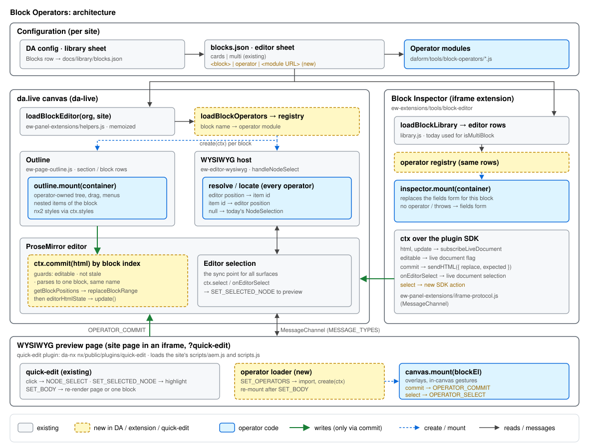

# Proposal: Block Operators, block-owned authoring in DA

## Problem
A block's authoring experience in DA canvas is fixed:
- **Outline** (`da-live/blocks/canvas/ew-page-outline/ew-page-outline.js`) shows each block as one row
  (`parseSections()` in `editor-utils/editor-utils.js`), with no view of the block's internal structure.
- **Block Inspector** (`adobe-rnd/ew-extensions/tools/block-editor`) builds its form from the library template's
  `fields` metadata, plus `multi` and `options` from the block library. It can't express a block-specific model.
- **Canvas selection**: a click in the WYSIWYG canvas sends `NODE_SELECT`, and `handleNodeSelect`
  (`ew-editor-wysiwyg/utils/handlers.js`) turns it into a ProseMirror `NodeSelection`. Nothing maps it to a block's
  own items. The preview DOM already carries ProseMirror positions (see
  [Layout view: item attributes](#layout-view-item-attributes)), but a click inside a block only uses the block's
  start: `blockSelectPayload` sends `{ anchorType: 'table', proseIndex }`, so the whole block is selected.

## Block operator
A **block operator** is a JS module configured for a block name. It can take over that block's authoring through
two optional **contracts**. An operator may implement both, one or neither of them:
| Contract | Surface | Host | If not implemented |
|---|---|---|---|
| `outline` | The nested area under the block's row in the Outline | DA | Today's single row |
| `inspector` | The Block Inspector panel, while the caret is in the block | Block Inspector extension | Today's `fields`-based form |



Inside a contract's surface, the operator owns everything: rendering, drag and drop, keyboard, menus, dialogs, actions
and gestures. The host provides only a mount point and `ctx`. The WYSIWYG canvas (DA's **Layout** view) has no
contract: no operator code runs in the site's page there. Instead the block marks its rendered items with attributes
that DA maps to the operator's items (see [Layout view: item attributes](#layout-view-item-attributes)).
- Drag and drop stays inside the mount. Operators don't accept drops from outside, and DA's outline drag/drop handlers
  ignore events from inside a mount.
- In the outline and the Block Inspector, operators use the nx2 styles (`nx2/styles/form.css`, `nx2/styles/buttons.css`).
  Both already load these as constructable sheets (`getSheet` in `ew-page-outline.js` and in `block-editor.js`), and pass
  them as `ctx.styles`.
- `ctx.commit(html)` is the only way to change the document, and it can only replace the operator's own block.

### Interface
```js
export default {
  matches({ name, variant }) { return true; },   // optional, e.g. to handle only some variants

  create(ctx) {                                  // once per block instance, per host
    return {
      update(nextCtx) {},                        // block HTML or editability changed
      destroy() {},
      resolve(position) {},                      // editor position in this block → item id, or null
      locate(itemId) {},                         // item id → editor position, or null
      outline:   { mount(container) { return { unmount() {} }; } },   // optional
      inspector: { mount(container) { return { unmount() {} }; } },   // optional
    };
  },
};
```
A **position** is `{ row, cell, textOffset? }`: `row` is the 0-based content row of the block (the block-name header row
is excluded), `cell` the 0-based cell in that row, and `textOffset` an optional character offset into that cell's text.
```ts
ctx = {
  name, variant, html,     // block identity and current HTML (EDS markup: <div class="name variant"><div><div>…)
  blockIndex,              // index of the block among the document's blocks
  editable,                // false when the doc is read-only
  styles,                  // nx2 stylesheets (outline and inspector)
  commit(html),            // replace this block (the host validates and applies)
                           //   → Promise<{ ok: true } | { ok: false, error, message }>
                           //   error: NOT_EDITABLE | STALE | INVALID_HTML | NO_EDITOR
  select(itemId),          // move the editor selection to an item (the host calls locate)
  onEditorSelect(cb),      // cb(itemId | null) when the editor selection moves inside this block (the host calls resolve)
}
```
DA and the Block Inspector each create their own operator instance. In DA, `select(itemId)` moves the editor caret
through the operator's `locate`, and `onEditorSelect` reports the caret back through `resolve`. The outline, the Block
Inspector and the Layout view share the selected item through [selection sync](#selection-sync), which runs in the site's
own code; DA only hosts the outline.

### `outline` (hosted by DA)
When a block row renders and its operator implements `outline`, DA renders an expand chevron and a container under the
row, then calls `outline.mount(container)`. Changes made in the mount are written with `ctx.commit`.

### `inspector` (hosted by the Block Inspector extension)
DA's tool panel is unchanged. The Block Inspector already follows the caret's block through the plugin SDK
(`subscribeLiveDocument`), writes with `sendHTML(html, { replace: true, expected })` (`document.js`), and loads the block
library's `editor` sheet (`library.js`, used for `isMultiBlock`). Changes:
1. Build an operator registry from the `editor` rows with `property: operator`.
2. When the selected block has an operator that implements `inspector`, mount it in the panel in place of the
   `fields` form. Otherwise, and if the operator throws, render today's form.
3. Back `ctx` with the SDK:
   | `ctx` | Backed by |
   |---|---|
   | `html`, `update()` | `subscribeLiveDocument` snapshots, narrowed to the selected block |
   | `editable` | The `editable` flag the host sends with the live document (`iframe-protocol.js`) |
   | `commit(html)` | `sendHTML(html, { replace: true, expected })` |
   | `onEditorSelect(cb)` | [Selection sync](#selection-sync) messages for this block |
   | `select(itemId)` | [Selection sync](#selection-sync): tells the outline (which moves the caret) and the Layout view |

## Layout view: item attributes
**Today:** DA's **Layout** view is the site's page in an iframe (`?quick-edit=on&controller=parent`), running the
quick-edit plugin (da-nx `nx/public/plugins/quick-edit`); **Preview** loads the page without `?quick-edit`. Host and page
talk over a MessageChannel using `MESSAGE_TYPES` (da-nx `nx/utils/message-types.js`, re-exported by da-live
`canvas/utils/quick-edit-messages.js`):
- Page → host: `NODE_SELECT { node: { anchorType, proseIndex, blockIndex? } | null }` on a click
  (`src/selection.js`), handled by `handleNodeSelect`, which sets a ProseMirror `NodeSelection`.
- Host → page: `SET_SELECTED_NODE { node, scrollIntoView }`, sent when the editor selection changes
  (`ew-editor-doc.js` `_broadcastSelectedNode`). `SET_BODY` re-renders the page, or just one block
  (`rerenderScope: { type: 'block', … }`).

`getInstrumentedHTML(view)` (da-live `editor-utils/editor-utils.js`) builds the body sent with `SET_BODY`. It clones the
ProseMirror DOM and stamps document positions on it before `prose2aem` serializes it:
| Attribute | On | Value | Used by quick-edit for |
|---|---|---|---|
| `data-block-index` | The block's wrapper `div` (moved there from a `block-marker` sentinel after serialization); metadata blocks are skipped | Position of the block's `table` + 1 | Block hover pill and selection (`blockSelectPayload` → `NODE_SELECT { anchorType: 'table' }` → `NodeSelection` at `proseIndex - 1`), operator lookup (`findLiveBlock`) |
| `data-prose-index` | The outermost editable element: `h1`–`h6`, `p`, `ol`, `ul`, `pre`, `blockquote`, also inside block cells | `view.posAtDOM(el, 0)`: start of that node's content | In-place text editing (`prose.js` mounts a ProseMirror editor on the element), remote cursors (`cursors.js`), drop targets (`drop.js`), re-indexing after edits (`dom-index.js`) |
| `data-image-index`, `data-image-version` | `img` | Position of the image node; document image version | Image selection (`NODE_SELECT { anchorType: 'image' }`), replace and drop |
| `data-cursor-remote`, `data-cursor-remote-color` | The outermost element with `data-prose-index` that holds a collaborator's cursor | Collaborator name and colour | Presence highlight |

The site's own `decorate()` runs on this markup, so these attributes survive only on elements the block keeps. The
accordion keeps its cells' `p` elements, so they keep `data-prose-index`. The form replaces its `pre` with a rendered
`<form>`, so inside it only the block wrapper's `data-block-index` survives. And these attributes point at editor
nodes: a form label is a substring of the `pre`'s JSON text, not a node, so `data-prose-index` can't address it.

**Proposed: the block marks its items.** In Layout only, a block adds two attributes to its rendered markup. No operator
code runs in the page, and quick-edit is unchanged.
| Attribute | On | Value |
|---|---|---|
| `data-item-id` | The element that renders an item (e.g. a form field's wrapper) | The operator's item id (for the form, the item's `id`, else `name`, else JSON pointer) |
| `data-item-prop` | A part of the item that shows one of its properties (label, help text, image) | The property, e.g. `label.value`, `description`, `value` |

The block knows it is in Layout from `?quick-edit` in the page URL, so Preview and the published page stay unchanged.
Editing those parts in place (quick-edit's rich-text toolbar or image replace on `[data-item-prop]`, saved through a new
operator method `setValue(itemId, prop, value)`) is a possible next step that would need quick-edit changes.

## Selection sync
The outline (in the da.live page), the Block Inspector (an iframe on the site's `preview.da.live` origin) and the Layout
view (the site's page in an iframe) show the same selected item. This runs in the site's code
(`scripts/block-operator-sync.js`), with no platform change beyond the outline host:
- **Message:** `{ type: 'block-operator-select', org, site, path?, blockIndex, block, itemId, source }`, where `source` is
  `outline`, `inspector` or `preview`. Item ids are stable across reordering (the form uses the item's `id`, then
  `name`, then its JSON pointer).
- **Outline → iframes:** on a selection in the tree, or when the editor caret moves to another item (`onEditorSelect`),
  the operator posts the message to every iframe in the page (shadow roots included) whose origin is the site's
  (`https://{ref}--{site}--{org}.preview.da.live`, `aem.page`, `aem.live`; a local server when DA runs locally), with that
  origin as `targetOrigin`. It keeps the last selection and answers `{ type: 'block-operator-get-selection' }`.
- **Iframes → outline:** the Block Inspector and the Layout view post to their parent (`https://da.live`, a da-live
  branch, or a local server) and share `BroadcastChannel('block-operators')`. The outline highlights the item, moves
  the caret with `select(itemId)`, and relays the message to the other iframes, so they stay in sync even on different
  origins.
- **Block Inspector:** asks the parent for the current selection when it loads and shows that item when it is in the
  selected block (same `blockIndex`, or the operator can `locate` it).
- **Layout view:** `blocks/form/formeditor.js` (loaded only with `?quick-edit`; `form.js` only renders and
  dispatches `form:rendered`) highlights `[data-item-id="…"]` and scrolls it into view, and on a click inside an item
  publishes it (`source: 'preview'`); quick-edit still handles the click.
- Every listener checks the sender's origin and ignores messages for another org or site. The Layout page counts blocks
  without auto-blocks the way DA does only approximately, so receivers also accept a message whose item their block has.

## `ctx.commit(html)` in DA
The SDK's `sendHTML` replace (`iframe-protocol.js`) rejects with `WRONG_SELECTION` or `STALE_LIVE` and then calls
`replaceHTMLAtCursor`. DA's operator commit uses similar guards, but targets the block **by index**:
1. Reject if the doc isn't editable (`view.editable`) or the block's HTML changed since the last `update`.
2. Take the block's start from `getBlockPositions` (`editor-utils/blocks.js`; the end is `pos + node.nodeSize`) and replace
   it with `replaceBlockRange(view, from, to, dom)`, which dispatches one `replaceWith`.
3. Reject if the HTML doesn't parse back to exactly one block of the same name.
4. On the following `editorHtmlState` update, call `update()` on the operator.

Whether one `replaceWith` is a single undo step needs verifying.

## Configuration: the block library's `editor` sheet
The block library index (the `Blocks` row of the DA config `library` sheet) can carry an `editor` sheet. da-live
(`editor-utils/multi-block.js`) and the Block Inspector already read it for `property: multi`:
| block | property | value |
|---|---|---|
| `cards` | `multi` | *(existing)* |
| `<block name>` | `operator` | `<operator module URL>` |

- `property: operator` and the `value` column (a JS module URL or site-relative path) are new.
- Operators are available only to sites with a block library, and are configured per site.

**Loading in DA:** `loadBlockEditor(org, site)` (`ew-panel-extensions/helpers.js`) already returns the `editor` rows,
memoized per org/site. A new `loadBlockOperators` filters them to `operator` and maps the block name, normalized as in
`multi-block.js`, to its module URL. The first row wins. A module is imported only when a matching block first
appears, and is then cached per block name. Until it loads, or if the import fails, the block keeps today's behaviour.
The outline uses this registry; the Block Inspector reads the same rows. When an operator
throws, DA destroys it for that block and falls back to the default behaviour.

## Where the operators live
- **Operator code**: `sakshi-arora1/daform/tools/block-operators/`: one module per operator, and a `README.md` describing
  the interface and the configuration (the Doc Url). The modules are served from the site:
  - `https://main--daform--sakshi-arora1.preview.da.live/tools/block-operators/accordion.js` (`resolve`, `locate`, `outline`)
  - `https://main--daform--sakshi-arora1.preview.da.live/tools/block-operators/form.js` (`resolve`, `locate`, `outline`,
    `inspector`); `blocks/form/formeditor.js` adds the Layout item attributes, and `scripts/block-operator-sync.js` syncs the selection
- **Setup**: add `operator` rows to the `editor` sheet of the site's block library (see the README). Open canvas tabs
  pick them up on reload. A setup app and a marketplace entry are out of scope for this repo.
